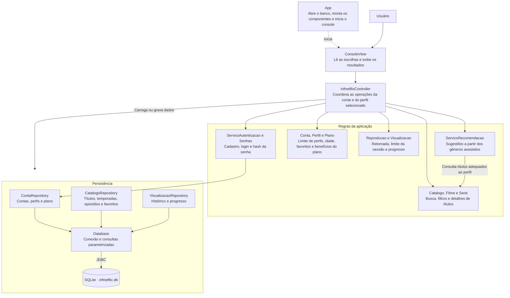
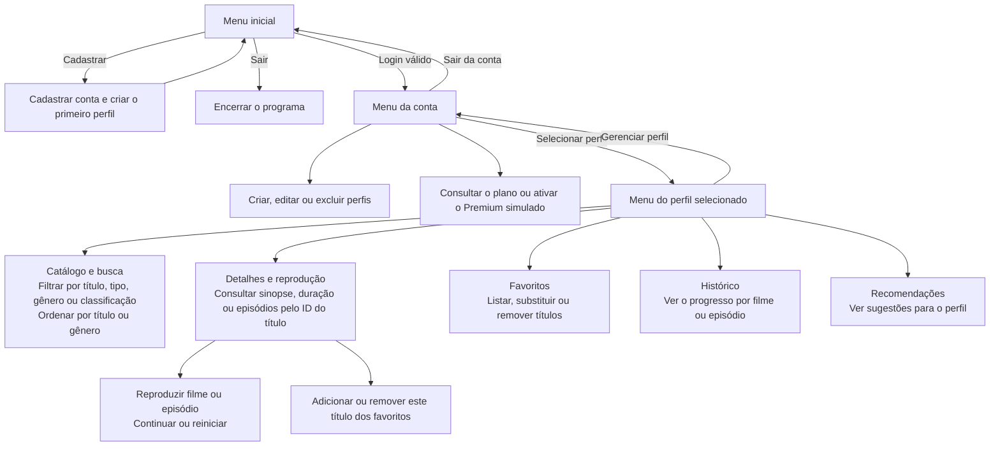
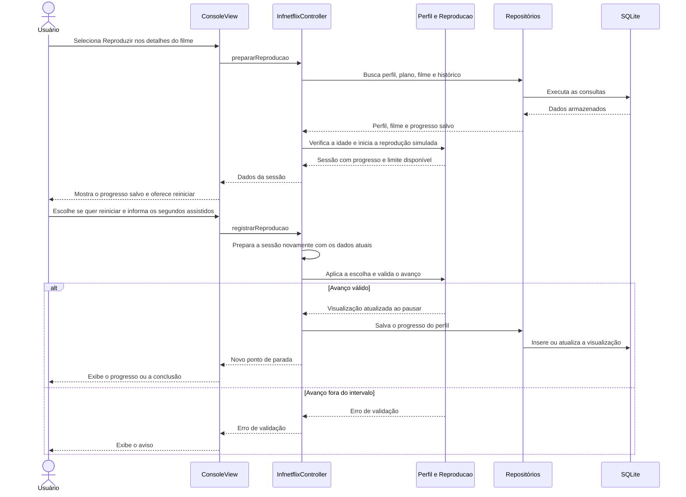

# Visão geral do INFNETFLIX

O INFNETFLIX é um protótipo de streaming em Java que roda no terminal. A conta reúne os perfis e o plano. Cada perfil tem sua própria lista de favoritos, seu histórico e recomendações adequadas à sua idade.

## Componentes e responsabilidades

## Navegação pelo console

O catálogo mostra o ID que o usuário pode informar em **Detalhes e reprodução**. A idade do perfil limita quais títulos aparecem no catálogo e nas recomendações, e também quais detalhes podem ser abertos.

## Como o sistema retoma e salva um filme

O plano gratuito exibe um anúncio simulado e permite até 20 minutos por sessão. O Premium simulado remove esse limite. O SQLite identifica cada progresso pelo perfil e pelo título. Para séries, registra também o episódio, de modo que cada episódio possa ser retomado separadamente.

[Casos de uso](casos-de-uso.md) · [Diagrama de classes](diagrama-de-classes.md)
